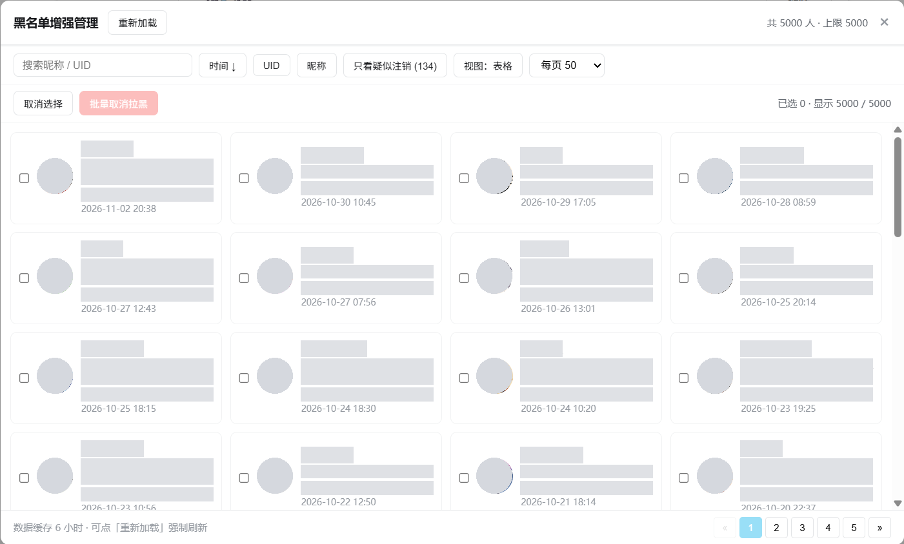
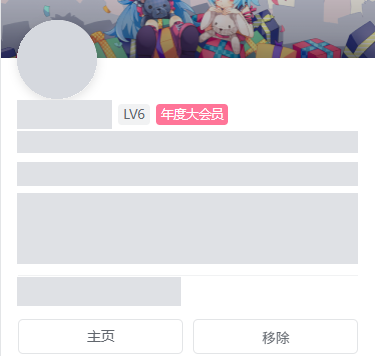

# B站黑名单增强管理

> 把 B 站那个「250 页翻到吐」的黑名单页面，变成一个能搜索、能排序、能批量操作的管理面板。

> 上图为实际运行截图，昵称、UID、签名、头像等隐私信息均已打码。

---

## 为什么需要它

B 站黑名单管理页的原生体验，实测数据如下：

| 项目 | 原生页面 | 本脚本 |
|---|---|---|
| 每页条数 | 20 | **50 / 90 / 140（本地渲染）** |
| 加载 5000 人 | 250 次翻页 | **100 次请求，约 25 秒，之后走本地缓存** |
| 搜索 | 无 | 昵称 / UID 即时过滤 |
| 排序 | 只能按时间 | 时间 / UID / 昵称，双向 |
| 批量操作 | 无，只能一条条点 | 多选 + 批量取消 |
| 显示 UID | 不显示 | 每行都有 |
| 显示签名 | 不显示 | 列表模式显示，卡片模式悬停展开 |
| 用户资料 | 无 | 悬停头像弹出名片（空间头图/等级/粉丝/获赞） |
| 识别死号 | 无 | 自动标记「已注销 / 疑似注销」 |

> 页面顶部写着「粉丝数<1万，黑名单上限为1000」，**这是过时文案**。实测上限就是 **5000**，与粉丝数无关（`pn=100` 有数据，`pn=101` 为空）。

---

## 功能一览

### 数据处理

- **全量拉取** — 一次把 5000 条全部拿到本地，之后搜索、排序、翻页全在内存里完成，不再请求
- **本地缓存** — 存在 `GM_setValue`，6 小时内重复打开秒开；点「重新加载」强制刷新
- **渐进进度** — 顶部进度条实时显示已拉取数量

### 浏览

| 能力 | 说明 |
|---|---|
| 🔍 本地搜索 | 昵称 / UID 模糊匹配，输入即过滤，零请求 |
| ↕️ 排序 | 拉黑时间、UID、昵称，点一次降序、再点升序 |
| 📋 列表模式 | 多列表格，一屏看到最多人，表头可点排序 |
| 🗂 表格模式 | 卡片网格，一行 4 个，悬停展开完整签名 + 移除按钮 |
| 📄 分页 | 每页 50 / 90 / 140 可切，纯本地渲染 |
| 🔒 滚动锁定 | 打开面板时锁住原页面滚动，不会误滚 |

### 识别

- **已注销**（红色） — 昵称被 B 站改写为 `账号已注销`
- **疑似注销**（黄色） — 头像为默认图 `noface.jpg`
- **只看疑似注销** — 过滤开关，一屏只剩待清理的账号
- **核验状态** — 逐个查接口核实真实状态，标出「已封禁」「已注销 LV0」「无头像 LVx」

> **核验状态**会用一次 `card` 接口同时拿到封禁状态与等级：`spacesta === -2` 是封禁，等级清零且仍留有历史数据是注销。
>
> B 站对该接口有**时间窗口配额**（约 100 次请求），连续查询会触发 `-352` 限流。脚本撞墙后会**停在断点**、等待 1 分钟自动重试，最多 3 轮，且**从断点续跑**（已查到的不会重复请求）。最终仍未查到的账号会被标成灰色「未核验」，随时可以再点一次继续。

### 操作

- **单条移除** — 列表每行、卡片悬停层、名片里都有入口
- **批量取消拉黑** — 多选后一次执行，带进度回显与失败名单
- **悬停名片** — 仿 B 站原生名片，含空间头图、等级、会员状态、关注/粉丝/获赞、认证、签名

所有写操作都有**自绘确认框**，禁用浏览器原生 `confirm`（原因见下方「踩坑记录」）。

---

## 安装

### 一键安装（推荐）

点一下按钮，脚本管理器会自动弹出安装页，确认即可。

> **原理**：脚本猫 / Tampermonkey 都会拦截所有以 `.user.js` 结尾的链接，把导航重定向到自己的安装界面。所以不需要任何特殊参数，一个普通链接就够了。实测点击后浏览器直接跳到 `chrome-extension://…/src/install.html#url=…`。

脚本托管在 GitHub，`@downloadURL` 与 `@updateURL` 已写进脚本头部——**装上之后会自动检查更新**，以后有新版本不用手动重新导入。

### 前置要求

- 浏览器：Chrome / Edge / 其他 Chromium 内核
- 用户脚本管理器：**[脚本猫 ScriptCat](https://github.com/scriptscat/scriptcat)**（开源、支持云同步）或 Tampermonkey
- 已登录 B 站

### 手动安装

1. 下载 [`bili-blacklist-manager.user.js`](https://raw.githubusercontent.com/lei39/bilibili-blacklist-manager/main/bili-blacklist-manager.user.js)（原始文件在 GitHub，也可从 [jsDelivr](https://cdn.jsdelivr.net/gh/lei39/bilibili-blacklist-manager@main/bili-blacklist-manager.user.js) 取）
2. 打开脚本猫管理面板 → **导入脚本** → 选择该文件
3. 确认安装，确保脚本处于**启用**状态
4. 打开 [B 站黑名单页面](https://account.bilibili.com/account/blacklist)，右下角会出现悬浮按钮

### 验证是否生效

页面右下角出现 `⚙ 黑名单增强` 按钮即安装成功。点开若能看到 `共 5000 人 · 上限 5000`，说明数据已拉通。

---

## 界面

点击页面右下角的 `⚙ 黑名单增强` 按钮，浮层如下（截图已对昵称、UID、签名、头像等隐私信息做打码处理）：

悬停头像弹出的用户名片（点击展开）

名片数据来自 `x/web-interface/card` 接口，一次请求即可拿到空间头图、等级、会员状态、
关注 / 粉丝 / 获赞、认证信息与个人签名。

### 两种视图的分工

| | 列表模式 | 表格模式 |
|---|---|---|
| 形态 | 多列表格，表头对齐 | 卡片网格，一行 4 个 |
| 密度 | 高，一屏 50 条 | 低，一屏约 20 个 |
| 签名 | 不显示 | 显示两行截断，悬停展开完整 |
| 适用 | 快速扫、批量勾选 | 判断"这人是谁" |

> 卡片悬停时，下沿会无缝展开一层显示完整签名与操作按钮。这里**刻意不改卡片高度**——那会触发 grid 重排，让下面所有卡片跳动。

---

## 疑似注销的判定方法

这是最容易误解的地方，说明清楚：

| 标记 | 判定条件 | 可信度 |
|---|---|---|
| 🔴 已注销 | `uname === '账号已注销'` | **高**。账号注销后 B 站会直接改写昵称，这个信号极可靠 |
| 🟡 疑似注销 | `face` 含 `noface`，即头像为 `https://i0.hdslb.com/bfs/face/member/noface.jpg` | **中**。可能是注销，也可能只是没传头像 |

> ⚠️ **本脚本不做任何自动删除。** 这两条只是特征标记，不代表账号真的注销。开启「只看疑似注销」时面板顶部会显示这段说明。批量移除不可撤销，请逐条确认。

脚本不提供「一键清理僵尸粉」的原因：误判一个人，他就重新能评论、@ 你、给你发私信，而 B 站没有回收站。

---

## 技术细节

### 使用的接口

| 用途 | 接口 | 备注 |
|---|---|---|
| 黑名单列表 | `GET /x/relation/blacks?pn=&ps=50` | `ps` 上限就是 50，传 100/200/500 都会被压回 50 |
| 取消拉黑 | `POST /x/relation/modify` | `fid=<mid>&act=6&re_src=11&csrf=<bili_jct>` |
| 重新拉黑 | `POST /x/relation/modify` | 同上，`act=5` |
| 用户名片 | `GET /x/web-interface/card?mid=&photo=true` | 一次拿全：等级/粉丝/获赞/认证/空间头图 |

### 性能与风控

| 项目 | 策略 |
|---|---|
| 全量拉取 | 100 次请求，每次间隔 180ms |
| 批量取消 | 每个间隔 350ms，顺序执行，失败记录 UID |
| 名片请求 | 悬停 220ms 后才发，按 mid 缓存，同一个人不会重复请求 |
| 缓存 | `GM_setValue`，TTL 6 小时 |

频率是保守取值。B 站对 `relation/modify` 有限流，间隔太短会返回错误码，脚本会在 toast 里提示失败。

### 为什么写操作都用自绘弹窗

脚本猫把用户脚本跑在**隔离环境**里，原生 `confirm()` / `alert()` 在这个环境下：

- **不会弹出任何窗口**
- **直接返回 `true`**

也就是说，用原生 `confirm` 做确认等于**没有确认**——用户点一下就已经执行完了。所以本项目所有写操作前都用自绘的 `.blm-modal` 异步确认，完成提示用自绘 toast。

> 这个坑是实际踩出来的：开发时测试移除按钮，本以为确认框会拦住，结果直接把一个账号取消了拉黑。

---

## 已知限制

- **仅支持 B 站黑名单页** — `@match` 限定 `account.bilibili.com/account/blacklist*`
- **需要登录态** — 所有接口走同源 cookie，未登录无法使用
- **不做粉丝数排序** — 批量接口（`account/v1/user/cards`、`polymer/pc-electron/v1/user/cards`）都不返回粉丝数，只能单人查 `x/relation/stat`，5000 人 = 5000 次请求，代价过高
- **重新拉黑会重置时间** — 若误删后重新拉黑，拉黑时间变为当天，无法还原
- **备注功能未实现** — 接口的 `tag` 字段恒为 `null`，B 站自己留了位置没做

---

## 更新日志

<b>v0.10.x</b> — 账号状态核验

- 新增「核验状态」按钮：逐个查 `card` 接口，核实封禁（`spacesta=-2`）与注销（等级清零但仍有历史数据）
- 标签区分「已封禁 / 已注销 / 已注销 LV0 / 无头像 LVx」，不再把「没传头像」等同于注销
- 按钮悬停提示 B 站接口的时间窗口配额与 `-352` 限流表现

<b>v0.8.1</b> — 疑似注销说明

- 「只看疑似注销」开启时，顶部显示判定依据与风险提示

<b>v0.8.0</b> — 自绘确认框

- 移除所有原生 `confirm` / `alert`，改为自绘模态框与 toast
- 批量操作确认框列出前 10 个账号昵称与 UID

<b>v0.7.x</b> — 悬停名片

- 逆向 B 站原生名片接口 `x/web-interface/card`
- 复刻空间头图 + 头像叠加布局
- 名片内加「主页 / 移除」按钮，加 260ms 离开宽限期

<b>v0.6.x</b> — 修复与打磨

- 修复切换视图后名片卡住不消失
- UID 从 8 位变 16 位导致截断 → 改为纵向两行布局

<b>v0.4.0 – v0.5.x</b> — 视图形态

- 确定「表格 = 卡片网格」「列表 = 多列表格」的命名
- 列表加移除按钮，卡片加悬停展开签名
- 修复卡片与展开层之间的白缝、圆角缺口、重复信息

<b>v0.1.0 – v0.3.0</b> — 起点

- 全量加载、搜索、排序、多选、批量取消、分页、视图切换
- 从就地 Tab 改为悬浮按钮 + 浮窗

---

## 免责声明

- 本项目仅用于**管理自己的黑名单**，所有请求以你自己的登录身份发出
- 批量操作会真实修改 B 站数据，**不可撤销**，请确认后再执行
- 接口行为可能随 B 站改版变化，脚本不保证长期可用
- 使用造成的任何后果由使用者自行承担

## 相关链接

- **[脚本猫 ScriptCat](https://github.com/scriptscat/scriptcat)** — 本脚本的安装与更新依赖它，开源、支持云同步
- [ScriptCat 脚本商店](https://scriptcat.org/) / [开发文档](https://docs.scriptcat.org/)
- [Tampermonkey](https://www.tampermonkey.net/) — 同样兼容，脚本格式完全一致

## License

MIT © 2026 lei39
